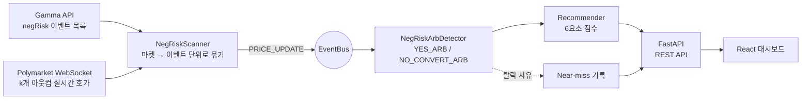
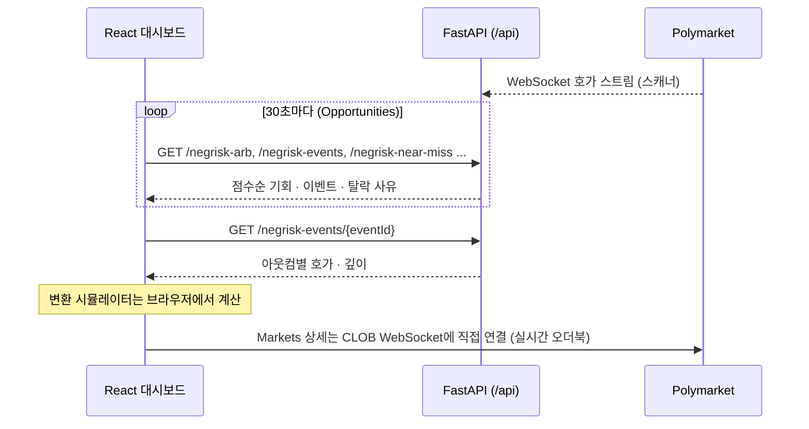

<p align="center">
  
</p>

<h1 align="center">Polly-Bot</h1>

<p align="center">
  Polymarket 다중 선택(NegRisk) 이벤트에서 <b>N개 아웃컴을 한 세트로 묶어</b> 차익을 계산하는 탐지 엔진 + 실시간 대시보드
</p>

<p align="center">
  <a href="https://github.com/hadan-HwH/polly-bot/actions/workflows/frontend.yml"></a>
</p>

---

## 목차

1. [프로젝트 정보](#1-프로젝트-정보)
2. [시작 가이드](#2-시작-가이드)
3. [기술 스택](#3-기술-스택)
4. [화면 구성 / API](#4-화면-구성--api)
5. [주요 기능](#5-주요-기능)
6. [아키텍처](#6-아키텍처)
7. [기타](#7-기타)

---

## 1. 프로젝트 정보

| 항목 | 내용 |
|---|---|
| 개발 기간 | 2026.03.22 ~ 2026.03.30 (9일) |
| 형태 | 개인 프로젝트 (기획 · 설계 · 개발 1인) |
| 담당 | 전략 명세(수식 · 엣지 케이스 · UI 명세), NegRisk 탐지 엔진, React 대시보드 전체 |
| 기반 | 오픈소스 봇 [karb](https://github.com/kmizzi/karb) 위에 확장 |
| 배포 | 없음 (로컬 실행 도구) |

### 프로젝트 소개

Polymarket의 "누가 이길까?" 같은 다중 선택 이벤트는 후보마다 YES/NO 마켓이 따로 거래됩니다.
오픈소스 봇 karb는 **마켓 하나**의 YES + NO 합이 1보다 작은지만 봅니다.
그런데 마켓을 하나씩 보면 가격이 맞아 보여도, 이벤트 전체를 한 세트로 묶으면 어긋나는 경우가 있습니다.

Polly-Bot은 **상호 배타적인 k개 아웃컴 전체**를 하나의 세트로 놓고, NegRisk 변환(NO 1개 = 나머지 k−1개의 YES)까지 반영해 차익을 계산합니다.
탐지한 기회는 점수순으로 정렬합니다. 대시보드의 시뮬레이터에서는 전략, 수량, 남길 NO를 바꿔 가며 비용과 수익을 바로 다시 계산할 수 있습니다.

| | karb (기존) | Polly-Bot (추가) |
|---|---|---|
| 분석 단위 | 마켓 1개 (YES·NO 2개) | 이벤트 1개 (아웃컴 **k개**, YES·NO **2k개**) |
| 차익 조건 | 마켓 하나의 YES+NO 합 | 이벤트 전체의 YES 합 / NO 합 |
| 쓰는 성질 | YES + NO = 1 | 완전 세트 + **NegRisk 변환** |
| 수량 결정 | 오더북 2개 | 오더북 k개 중 **가장 얕은 곳이 병목** |
| 청산 | 만기 정산 | 변환 + merge로 **즉시 청산** ("하나 남기기") |

---

## 2. 시작 가이드

### 요구 사항

| 대상 | 버전 |
|---|---|
| 프론트엔드 | Node.js 22, npm |
| 백엔드 (원 시스템) | Python 3.12+ |

### 설치 및 실행

프론트엔드는 이 저장소만으로 테스트·빌드됩니다.

```bash
git clone https://github.com/hadan-HwH/polly-bot.git
cd polly-bot/frontend
npm ci
npm test          # Vitest 49개
npm run build     # 타입체크 + 프로덕션 빌드
npm run dev       # 개발 서버 (/api 요청은 localhost:8000 백엔드로 프록시)
```

> 이 저장소는 포트폴리오용 **발췌본**입니다([7. 기타](#이-저장소에-담은-것--뺀-것) 참고).
> Python 모듈은 karb 원본 코드 위에서 동작해서 이 저장소만으로는 실행되지 않습니다. 원 시스템에서는 아래처럼 실행합니다.

```bash
pollybot negrisk      # NegRisk 스캐너 (탐지 + 로그)
pollybot dashboard    # API 서버 + 대시보드
pollybot run          # 봇 실행 (기본 dry-run)
```

---

## 3. 기술 스택

**Language**


**Backend**


**Frontend**


**Test & CI**


---

## 4. 화면 구성 / API

### 화면 구성

| 화면 | 경로 | 보여주는 것 |
|---|---|---|
| Dashboard | `/dashboard` | Pure Arb · NegRisk 스캐너 상태, 모니터링 마켓 수, 지갑 상태, 최근 활동 |
| **Opportunities** | `/negrisk` | 탐지된 기회를 이벤트별로 묶어 점수순 표시. 전략 필터(YES / NO), Near-miss · 실행 내역 · 진단(탐지기 통계) 탭 |
| **Event Detail** | `/negrisk/:eventId` | 아웃컴별 YES·NO 호가와 깊이 테이블, **변환 시뮬레이터** |
| Markets | `/markets`, `/markets/:slug` | 전체 마켓 탐색. 상세 화면은 실시간 오더북 표시 |
| Pure Arb | `/arb` | 기존 2-아웃컴 전략 모니터링 |
| Portfolio | `/portfolio` | 포지션 · 손익 |
| Settings | `/settings` | 스캔 모드, 최소 수익률, 안전마진, 최소 유동성, 만기 필터, 아웃컴 수 범위, 주문 유형(FOK/GTC) |

### API

프론트엔드가 쓰는 백엔드 API 중 NegRisk 관련 엔드포인트입니다. 전체 목록은 [docs/architecture.md](docs/architecture.md#api-엔드포인트-전체)에 있습니다.

| Method | Path | 설명 |
|---|---|---|
| GET | `/api/negrisk-events` | NegRisk 이벤트 목록 + 아웃컴별 가격 |
| GET | `/api/negrisk-events/{eventId}` | 이벤트 상세 (아웃컴별 호가 · 깊이 · 조건 충족 여부) |
| GET | `/api/negrisk-arb` | 탐지된 기회 (점수 · 순위 포함) |
| GET | `/api/negrisk-near-miss` | 조건은 맞았지만 탈락한 이벤트 + 사유 |
| GET | `/api/negrisk-stats` | 스캐너 · 탐지기 통계 |
| GET | `/api/negrisk-executions` | 실행 이력 |
| GET / PUT | `/api/settings` | 임계값 조회 · 변경 |

---

## 5. 주요 기능

### 5-1. N개 아웃컴 차익 계산 (핵심)

```math
\text{karb:}\quad p^{YES} + p^{NO} < 1
```

```math
\text{YES\_ARB:}\quad \sum_{i=1}^{k} p_i^{YES} < 1 - a
\qquad\qquad
\text{NO\_CONVERT\_ARB:}\quad \sum_{i=1}^{k} p_i^{NO} < (k-1) - a
```

`NO_CONVERT_ARB`가 핵심입니다. NegRisk 어댑터에서는 $NO_i \equiv \{YES_j : j \ne i\}$ 입니다.
그래서 k개 아웃컴의 NO를 1개씩 사서 변환하면 완전한 YES 세트가 k−1개 생기고, 이는 곧 k−1 USDC입니다.
비교 기준이 1이 아니라 **k−1**인 이유입니다.

```math
\Pi = j \left[ (k-1) - \sum_{i=1}^{k} p_i^{NO} \right] - \text{fees},
\qquad
j = \left\lfloor r \cdot \min_i d_i \right\rfloor
```

(`a`: 안전마진, `d_i`: 아웃컴 i의 목표가까지 누적 호가 물량, `r`: depth ratio, 기본 0.5)

**예시: karb에는 안 보이고 Polly-Bot에는 보이는 기회 (k = 4)**

| 아웃컴 | YES 매도호가 | NO 매도호가 | YES+NO (karb가 보는 값) |
|---|---|---|---|
| A | 0.43 | 0.58 | 1.01 |
| B | 0.32 | 0.69 | 1.01 |
| C | 0.22 | 0.79 | 1.01 |
| D | 0.14 | 0.87 | 1.01 |
| **합** | 1.11 | **2.93** | |

- **karb**: 4개 마켓 모두 YES+NO = 1.01 ≥ 1 → 기회 없음
- **Polly-Bot**: Σ NO = 2.93 < k−1 = 3 → NO 4개 한 세트를 2.93 USDC에 사서 3 USDC로 청산.
  세트당 0.07 USDC (수익률 2.39%, 수수료·안전마진 차감 전)

**"하나 남기기" 청산.** NO_A는 그대로 두고 NO_B·NO_C·NO_D만 변환하면 보유량은 NO_A 1, YES_A 3, YES_B·C·D 각 2가 됩니다.
NO_A + YES_A로 1 USDC, 남은 YES로 완전 세트 2개를 만들어 2 USDC, 합쳐서 k−1 = 3 USDC를 만기까지 기다리지 않고 바로 회수합니다.

### 5-2. 거짓 기회 걸러내기

수식은 간단합니다. 실제 시장에서는 가짜 기회를 걸러내는 쪽이 어렵습니다.

- **활성 아웃컴만 센다 (`k_active`)**: 이미 사실상 결정된 아웃컴은 호가가 사라집니다. 이런 아웃컴은 k에서 빼고 기준선을 `k_active − 1`로 다시 계산합니다.
- **호가 없음 ≠ 0원**: YES 호가창이 비어 있는(illiquid) 아웃컴은 가치가 높을 수도 있습니다. 하나라도 있으면 YES_ARB를 거부합니다.
- **수량 j는 가장 얕은 오더북이 정한다**: 모든 아웃컴을 같은 수량만큼 사야 해서, 가장 얕은 오더북 깊이의 50%만 씁니다.
- **동적 안전마진**: `a = 예상 슬리피지(j) + 가스비 × (변환 횟수 + 1) + 버퍼`
- **일부만 체결됐을 때 (Retry-then-Hold)**: 손절(Unwind) · 보유(Hold) · 재시도(Retry)의 기대값을 비교했습니다. Unwind < Hold ≈ 0 < Retry이므로, 수익성을 다시 확인한 뒤 최대 2회 재시도하고 그래도 안 되면 보유합니다.

### 5-3. 추천 점수와 Near-miss

- 기회마다 **ROI 30% · 유동성 25% · 실행 가능성 15% · 마켓 규모 10% · 전략 선호 10% · 만기 근접도 10%**로 점수를 매겨 순위를 정합니다.
- 조건은 만족했지만 안전마진·ROI·유동성에서 떨어진 이벤트는 **사유와 함께 Near-miss로 기록**해서 임계값을 조정할 때 씁니다.

### 5-4. 변환 시뮬레이터

Event Detail 화면에서 전략(YES_ARB / NO_CONVERT_ARB), 수량 j, 남길 NO를 바꾸면 총비용 · 회수액 · 가스비 · 순이익 · ROI가 브라우저에서 바로 다시 계산됩니다. 수수료를 빼고 손실이면 경고를 띄웁니다.

---

## 6. 아키텍처

### 시스템 구조



기존 karb 코드는 지우지 않고 **추가만** 했습니다. 이벤트 버스(pub/sub)를 둬서 karb의 Pure Arb 경로와 NegRisk 경로가 병렬로 동작합니다.

### 프론트엔드 ↔ 백엔드 통신 흐름



- 목록 화면은 REST 폴링입니다. 갱신 주기는 Dashboard 10초, Pure Arb 15초, Opportunities 30초, Portfolio 60초입니다.
- 응답의 snake_case 키는 API 클라이언트(`lib/api/transform.ts`)에서 camelCase로 바꿉니다.
- 프론트는 `components/ui/` 래핑 레이어로 UI 킷 의존을 한 곳에 가뒀습니다. 페이지는 래퍼만 씁니다.

### 디렉토리 구조

```
polly-bot/
├── docs/                          # 기획 문서
│   ├── negrisk-strategy.md        #   전략 명세: 수식 · 엣지 케이스 · 수량 결정 · 부분 체결 EV · UI 명세
│   ├── architecture.md            #   시스템 구조 · 데이터 흐름 · API 목록
│   └── phase1.md ~ phase3.md      #   단계별 구현 계획
├── src/karb/                      # NegRisk 모듈 (karb 패키지 확장)
│   ├── analyzer/
│   │   ├── negrisk_arb.py         #   YES_ARB / NO_CONVERT_ARB 탐지 · j · 안전마진 · near-miss
│   │   └── recommender.py         #   6요소 점수 · 순위
│   ├── scanner/negrisk_scanner.py #   negRisk 이벤트 수집 · 아웃컴 호가 구독
│   ├── api/negrisk_models.py      #   이벤트 · 기회 · 변환 계획 모델
│   ├── events/                    #   EventBus (pub/sub) · 이벤트 타입
│   ├── data/market_sync.py        #   마켓 백그라운드 동기화
│   └── utils/categorizer.py       #   마켓 카테고리 분류
├── tests/unit/                    # pytest 131개
└── frontend/src/
    ├── pages/                     # Dashboard · Opportunities · EventDetail · Markets · PureArb · Portfolio · Settings
    ├── components/negrisk/        # ConversionSimulator · PriceTable · StrategyBadge · TradePanel
    ├── components/ui/             # UI 킷 래핑 레이어 (DataTable · AppTabs · EventAccordion ...)
    ├── hooks/                     # 실시간 스트림 훅
    ├── lib/api/ · lib/ws/         # REST · WebSocket 클라이언트
    ├── types/                     # API 응답 타입
    └── __tests__/                 # Vitest 49개
```

---

## 7. 기타

### 어떻게 기획했나

1. **전략 문서부터 썼습니다.** 토큰 등가 규칙 3개, 두 전략의 수식, 엣지 케이스, 수량 결정, 안전마진, 부분 체결 EV, UI 명세까지 코드보다 먼저 확정했습니다.
2. **Phase로 나눠 구현했습니다.** Phase 1은 탐지 엔진 + 대시보드, Phase 2는 전체 마켓 · Pure Arb · 설정, Phase 3는 지갑 연결 · 실행 · 포트폴리오입니다.
3. **기존 코드는 건드리지 않고 확장했습니다.** 이벤트 버스로 기존 경로와 분리했고, UI 킷 의존은 래핑 레이어에 가뒀습니다.

### 개발 문서

| 문서 | 내용 |
|---|---|
| [negrisk-strategy.md](docs/negrisk-strategy.md) | 전략 명세 (수식 유도 · 예시 · 엣지 케이스 · UI 명세) |
| [architecture.md](docs/architecture.md) | 시스템 구조 · 데이터 흐름 · API 목록 · 이벤트 버스 |
| [phase1.md](docs/phase1.md) | Phase 1: NegRisk 탐지 엔진 + React 대시보드 |
| [phase2.md](docs/phase2.md) | Phase 2: 전체 마켓 · Pure Arb · 설정 |
| [phase3.md](docs/phase3.md) | Phase 3: 지갑 연결 · 실행 · 포트폴리오 |

### 이 저장소에 담은 것 / 뺀 것

| 담은 것 | 경로 |
|---|---|
| NegRisk 탐지 · 스캐너 · 추천 · 이벤트 버스 · 모델 (Python) | `src/karb/` |
| React 대시보드 전체 소스 · API/WS 클라이언트 | `frontend/src/` |
| 테스트: Python 131개, 프론트 49개 | `tests/`, `frontend/src/__tests__/` |
| 전략 · 아키텍처 · Phase 기획 문서 | `docs/` |

| 뺀 것 | 이유 |
|---|---|
| karb 원본 코드 (API 클라이언트, 설정, 데이터 레이어 등) | 업스트림에 라이선스가 없어 재배포하지 않음 |
| 실제 주문 실행 · 온체인 변환 레이어 | 공개 범위에서 제외 |
| UI 킷 스타일 레이어 (Tailwind 플러그인 · 테마 CSS) | 유료 킷(Domiex) 라이선스 |

Python 테스트 131개는 원 시스템(karb + 이 모듈)에서 통과하는 것을 확인했습니다.
프론트엔드는 UI 킷 스타일만 빠져 있어서 단독으로 빌드는 되지만 화면이 원본처럼 보이지는 않습니다.

### Credits

- [karb](https://github.com/kmizzi/karb): WebSocket · CLOB 클라이언트 · 데이터 레이어 기반 (Pure Arb)
- [Polymarket NegRisk CTF Adapter](https://github.com/Polymarket/neg-risk-ctf-adapter)
- Domiex: React 관리자 UI 킷
