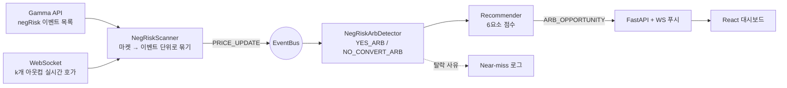

# Polly-Bot

**Polymarket 다중 선택(NegRisk) 이벤트에서 N개 아웃컴을 한 세트로 묶어 차익을 계산하는 탐지 엔진 + 실시간 대시보드**

오픈소스 봇 [karb](https://github.com/kmizzi/karb)는 **YES/NO 2개짜리 마켓 하나**만 봅니다.
Polly-Bot은 "누가 이길까?" 같은 **상호 배타적인 k개 아웃컴 전체**를 하나의 세트로 계산합니다.
마켓을 하나씩 보면 가격이 맞아 보여도, 이벤트 전체로 묶으면 어긋나는 지점이 있기 때문입니다.

`Python` · `FastAPI` · `WebSocket` · `React 19` · `TypeScript` · `TanStack Table` · `Tailwind v4` · `Vitest`

---

## 2개 → N개: 무엇을 새로 계산했나

| | karb (기존) | Polly-Bot (추가) |
|---|---|---|
| 분석 단위 | 마켓 1개 (YES·NO 2개) | 이벤트 1개 (아웃컴 **k개**, YES·NO **2k개**) |
| 차익 조건 | 마켓 하나의 YES+NO 합 | 이벤트 전체 YES 합 / NO 합 |
| 쓰는 성질 | YES + NO = 1 | 완전 세트 + **NegRisk 변환** (NO 1개 = 나머지 k−1개의 YES) |
| 수량 결정 | 오더북 2개 | 오더북 k개 중 **가장 얕은 곳이 병목** |
| 청산 | 만기 정산 | 변환 + merge로 **즉시 청산** ("하나 남기기") |

### 조건식

```math
\text{karb:}\quad p^{YES} + p^{NO} < 1
```

```math
\text{YES\_ARB:}\quad \sum_{i=1}^{k} p_i^{YES} < 1 - a
\qquad\qquad
\text{NO\_CONVERT\_ARB:}\quad \sum_{i=1}^{k} p_i^{NO} < (k-1) - a
```

`NO_CONVERT_ARB`가 핵심입니다. NegRisk 어댑터에서는 $NO_i \equiv \{YES_j : j \ne i\}$ 이므로,
k개 아웃컴의 NO를 1개씩 사서 변환하면 완전한 YES 세트가 k−1개 생기고, 이는 곧 k−1 USDC입니다.
그래서 비교 기준이 1이 아니라 **k−1**이 됩니다.

```math
\Pi = j \left[ (k-1) - \sum_{i=1}^{k} p_i^{NO} \right] - \text{fees},
\qquad
j = \left\lfloor r \cdot \min_i d_i \right\rfloor
```

(`a`: 안전마진, `d_i`: 아웃컴 i의 목표가까지 누적 호가 물량, `r`: depth ratio, 기본 0.5)

### 예시: karb에는 안 보이고 Polly-Bot에는 보이는 기회 (k = 4)

| 아웃컴 | YES 매도호가 | NO 매도호가 | YES+NO (karb가 보는 값) |
|---|---|---|---|
| A | 0.43 | 0.58 | 1.01 |
| B | 0.32 | 0.69 | 1.01 |
| C | 0.22 | 0.79 | 1.01 |
| D | 0.14 | 0.87 | 1.01 |
| **합** | 1.11 | **2.93** | |

- **karb**: 4개 마켓 모두 YES+NO = 1.01 ≥ 1 → 기회 없음
- **Polly-Bot**: Σ NO = 2.93 < k−1 = 3 → NO 4개 한 세트를 2.93 USDC에 사서 3 USDC로 청산.
  세트당 0.07 USDC(수익률 2.39%, 수수료·안전마진 차감 전)

**"하나 남기기" 청산.** NO_A는 그대로 두고 NO_B·NO_C·NO_D만 변환하면 보유량은 NO_A 1, YES_A 3, YES_B·C·D 각 2가 됩니다.
여기서 NO_A + YES_A로 1 USDC, 남은 YES로 완전 세트 2개를 만들어 2 USDC, 합쳐서 k−1 = 3 USDC를 만기까지 기다리지 않고 바로 회수합니다.

---

## 계산이 실제로 다루는 것

수식은 간단합니다. 실제 시장에서는 "거짓 기회"를 걸러내는 쪽이 어렵습니다.

- **활성 아웃컴만 센다 (`k_active`)**: 이미 사실상 결정된 아웃컴은 호가가 사라집니다. 이런 아웃컴은 k에서 빼고 기준선을 `k_active − 1`로 다시 계산합니다.
- **호가 없음 ≠ 0원**: YES 호가창이 비어 있는(illiquid) 아웃컴은 가치가 높을 수도 있습니다. 하나라도 있으면 YES_ARB를 **거부**합니다. 0으로 치고 합산하면 가짜 기회가 잡힙니다.
- **수량 j는 가장 얕은 오더북이 정한다**: 모든 아웃컴을 같은 수량만큼 사야 해서, 가장 얕은 오더북 깊이의 50%만 씁니다. 그 이상 사면 다음 호가까지 밀려 슬리피지가 커집니다.
- **동적 안전마진**: `a = 예상 슬리피지(j) + 변환 가스비 + 버퍼`
- **일부만 체결됐을 때 (Retry-then-Hold)**: k개 주문 중 일부만 체결되면 손절(Unwind) · 보유(Hold) · 재시도(Retry) 세 경로의 기대값(EV)을 비교했습니다. 순서는 Unwind < Hold ≈ 0 < Retry입니다. 그래서 수익성을 다시 확인한 뒤 최대 2회 재시도하고, 그래도 안 되면 보유합니다.
- **추천 점수**: ROI 30% · 유동성 25% · 실행 가능성 15% · 마켓 규모 10% · 전략 선호 10% · 만기 근접도 10%로 순위를 매깁니다.
- **Near-miss 기록**: 조건은 만족했지만 안전마진·ROI·유동성에서 떨어진 이벤트를 사유와 함께 남겨 임계값 튜닝에 씁니다.

전체 유도와 엣지 케이스는 [docs/negrisk-strategy.md](docs/negrisk-strategy.md)에 있습니다.

---

## 어떻게 기획하고 만들었나

1. **전략 문서부터 썼습니다.** 토큰 등가 규칙 3개, 두 전략의 수식, 엣지 케이스, 수량 결정, 안전마진, 부분 체결 EV, UI 명세까지 코드보다 먼저 문서로 확정했습니다. → [negrisk-strategy.md](docs/negrisk-strategy.md)
2. **Phase로 나눴습니다.**
   - [Phase 1](docs/phase1.md): NegRisk 탐지 엔진 + React 대시보드
   - [Phase 2](docs/phase2.md): 전체 마켓 · Pure Arb · 설정 화면
   - [Phase 3](docs/phase3.md): 지갑 연결 · 실행 · 포트폴리오
3. **기존 코드는 지우지 않고 "추가만" 했습니다.** 이벤트 버스(pub/sub)를 두어 karb의 Pure Arb 경로와 NegRisk 경로가 병렬로 동작하게 했습니다. 프론트는 `components/ui/` 래핑 레이어로 UI 킷 의존을 한 곳에 가뒀습니다. → [architecture.md](docs/architecture.md)



---

## 어떻게 쓰나

**대시보드**

- **Opportunities**: 탐지된 기회를 이벤트별로 묶어 점수순으로 보여줍니다. 전략 필터(YES / NO), Near-miss 탭, 실행 이력 탭이 있습니다.
- **Event Detail**: 아웃컴별 YES·NO 호가와 깊이 테이블을 보여줍니다. **변환 시뮬레이터**에서 수량 j, 남길 NO, 안전마진을 바꾸면 비용·수익·청산 경로가 바로 다시 계산됩니다.
- **Markets / Pure Arb / Portfolio / Settings**: 전체 마켓 탐색, 기존 2-아웃컴 전략 모니터링, 포지션, 임계값 설정 화면입니다.

**CLI (원 시스템 기준)**

```bash
pollybot negrisk      # NegRisk 스캐너 실행 (탐지 + 로그)
pollybot dashboard    # API 서버 + 대시보드
pollybot run          # 봇 실행 (기본 dry-run)
```

---

## 이 저장소에 대해

포트폴리오용 **발췌본**입니다. 제가 직접 만든 부분만 담았습니다.

| 담은 것 | 경로 |
|---|---|
| NegRisk 탐지 · 스캐너 · 추천 · 이벤트 버스 · 모델 (Python) | `src/karb/` |
| React 대시보드 전체 소스 · API/WS 클라이언트 | `frontend/src/` |
| 테스트: Python 131개, 프론트 49개 | `tests/`, `frontend/src/__tests__/` |
| 전략 · 아키텍처 · Phase 기획 문서 | `docs/` |

| 뺀 것 | 이유 |
|---|---|
| karb 원본 코드 (API 클라이언트, 설정, 데이터 레이어 등) | 업스트림에 라이선스가 없어 재배포하지 않음 |
| 실제 주문 실행 · 온체인 변환 레이어 | 공개 범위에서 제외 |
| UI 킷 스타일 레이어 (Tailwind 플러그인 · 테마 CSS) | 유료 킷(Domiex) 라이선스 |

그래서 **Python 코드는 이 저장소만으로는 실행되지 않습니다.** 원 시스템(karb + 이 모듈)에서 테스트 131개가 통과하는 것을 확인했습니다.
**프론트엔드는 단독으로 테스트·빌드됩니다.** UI 킷 스타일만 빠져 있어서 화면이 원본처럼 보이지는 않습니다.

```bash
cd frontend
npm ci
npm test         # Vitest 49개
npm run build    # 타입체크 + 빌드
```

## Credits

- [karb](https://github.com/kmizzi/karb): WebSocket · CLOB 클라이언트 · 데이터 레이어 기반 (Pure Arb)
- [Polymarket NegRisk CTF Adapter](https://github.com/Polymarket/neg-risk-ctf-adapter)
- Domiex: React 관리자 UI 킷
