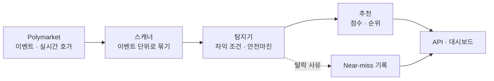

<p align="center">
  
</p>

<h1 align="center">Polly-Bot</h1>

<p align="center">
  다중 선택 예측시장에서 여러 결과를 한 세트로 묶어<br>
  차익 기회를 계산하는 탐지 엔진과 대시보드
</p>

<p align="center">
  <a href="https://github.com/hadan-HwH/polly-bot/actions/workflows/frontend.yml">
    
  </a>
  
</p>

<p align="center"><sub>개인 프로젝트 · 2026.03 · 포트폴리오용 발췌본</sub></p>

---

## 프로젝트 소개

Polymarket의 다중 선택 이벤트는 후보마다 YES/NO 마켓이 따로 거래됩니다. 마켓을 하나씩 보면 가격이 맞아 보여도, 이벤트 전체를 한 세트로 묶으면 차익이 생기는 경우가 있습니다.

**Polly-Bot**은 오픈소스 봇 [karb](https://github.com/kmizzi/karb)를 확장해, 마켓 하나가 아니라 **k개 결과 전체를 한 세트로** 계산합니다. NegRisk 변환까지 반영해 차익을 계산하고, 탐지한 기회를 점수순으로 대시보드에 보여줍니다.

목표는 **기존 봇이 보지 못하는 구조적 가격 불일치를 찾아내는 것**입니다.

## 주요 기능

| 기능 | 설명 |
| --- | --- |
| **다중 결과 차익 계산** | k개 결과 전체의 YES 합 · NO 합을 기준으로 차익 조건을 계산합니다. |
| **거짓 기회 필터링** | 결정된 결과 제외, 호가 공백 처리, 동적 안전마진으로 실행할 수 없는 기회를 걸러냅니다. |
| **기회 순위화** | 수익률 · 유동성 · 실행 가능성 등 6가지 요소로 점수를 매깁니다. |
| **탈락 사유 기록** | 조건은 맞았지만 탈락한 기회를 사유와 함께 남겨 임계값 조정에 활용합니다. |
| **변환 시뮬레이터** | 전략 · 수량 · 남길 결과를 바꾸며 비용과 순이익을 즉시 계산합니다. |

### 계산 예시

기존 봇(karb)에는 보이지 않고 Polly-Bot에는 보이는 기회입니다(결과 4개).

| 결과 | YES 매도호가 | NO 매도호가 | YES + NO |
| :---: | :---: | :---: | :---: |
| A | 0.43 | 0.58 | 1.01 |
| B | 0.32 | 0.69 | 1.01 |
| C | 0.22 | 0.79 | 1.01 |
| D | 0.14 | 0.87 | 1.01 |
| **합** | 1.11 | **2.93** | |

- **karb:** 4개 마켓 모두 YES + NO = 1.01 ≥ 1 → 기회 없음
- **Polly-Bot:** NO 합 2.93 < k − 1 = 3 → NO 한 세트를 2.93 USDC에 사서 3 USDC로 회수, 세트당 0.07 USDC(수익률 2.39%)

<sub>설명을 위해 구성한 예시 수치입니다.</sub>

## 기술적 접근

```math
\text{karb:}\quad p^{YES} + p^{NO} < 1
\qquad\qquad
\text{Polly-Bot:}\quad \sum_{i=1}^{k} p_i^{NO} < (k-1) - a
```

NegRisk 어댑터에서 NO 1개는 나머지 k − 1개 결과의 YES와 같습니다. 그래서 NO를 한 세트 사서 변환하면 완전한 YES 세트가 k − 1개 생기고, 비교 기준이 1이 아니라 **k − 1**이 됩니다. 이 원리로 YES 합이 1보다 작은 경우와 NO 합이 k − 1보다 작은 경우를 함께 탐지합니다.



- **기존 코드 확장:** karb 코드는 그대로 두고 이벤트 버스로 NegRisk 경로를 추가해, 기존 전략과 병렬로 동작합니다.
- **수량 결정:** 모든 결과를 같은 수량만큼 사야 하므로, 가장 얕은 오더북 깊이의 일부만 사용합니다.
- **부분 체결 대응:** 일부 주문만 체결되면 기대값을 비교해 재시도한 뒤, 실패하면 보유합니다(Retry-then-Hold).
- **즉시 청산:** 결과 하나를 남기고 나머지를 변환한 뒤 merge해, 만기를 기다리지 않고 회수합니다.

수식 유도와 예외 처리는 [전략 문서](docs/negrisk-strategy.md)에서 확인할 수 있습니다.

## 실행 및 확인

Node.js 22 환경이 필요합니다. 프론트엔드는 이 저장소만으로 테스트와 빌드가 가능합니다.

```bash
git clone https://github.com/hadan-HwH/polly-bot.git
cd polly-bot/frontend
npm ci

# 테스트 실행
npm test

# 프로덕션 빌드
npm run build
```

원 시스템(karb 포함)에서는 다음 명령으로 스캐너와 대시보드를 실행합니다.

```bash
pollybot negrisk      # NegRisk 스캐너
pollybot dashboard    # API 서버 · 대시보드
```

## 프로젝트의 출발점

오픈소스 봇 karb는 마켓 하나의 YES + NO 합만 확인하기 때문에, 다중 선택 이벤트 전체에 걸친 가격 불일치는 찾을 수 없었습니다. 이 한계를 보완하기 위해 Polly-Bot을 기획했습니다.

코드보다 **전략 문서를 먼저 작성**해 수식 · 예외 상황 · 화면 명세를 확정했고, 탐지 · 대시보드 → 전체 마켓 · 설정 → 실행 · 포트폴리오 순으로 단계를 나눠 구현했습니다.

## 현재 상태와 한계

이 저장소는 **2026년 3월 22일부터 3월 30일까지 개발한 개인 프로젝트의 포트폴리오용 발췌본**입니다.

| 항목 | 현재 상태 |
| --- | --- |
| **실행 범위** | Python 모듈은 karb 원본 위에서 동작하므로 이 저장소만으로는 실행되지 않습니다. 테스트는 원 시스템에서 통과를 확인했습니다. |
| **비공개 범위** | 주문 실행과 온체인 변환 코드는 포함하지 않았습니다. |
| **원본 코드** | karb 원본은 업스트림 라이선스가 없어 포함하지 않았습니다. |
| **화면 스타일** | 유료 UI 킷의 스타일을 제외해, 프론트엔드는 빌드되지만 원본과 화면이 다릅니다. |

## 기술 및 문서

**Python 3.12 · FastAPI · asyncio · WebSocket · SQLite · React 19 · TypeScript · Vite · Tailwind CSS · pytest · Vitest · GitHub Actions**

| 문서 | 내용 |
| --- | --- |
| [Strategy](docs/negrisk-strategy.md) | 차익 조건 수식, 예외 처리, 화면 명세 |
| [Architecture](docs/architecture.md) | 시스템 구조와 API |
| [Phase 1](docs/phase1.md) · [2](docs/phase2.md) · [3](docs/phase3.md) | 단계별 구현 계획 |

<sub>기반: [karb](https://github.com/kmizzi/karb) · [Polymarket NegRisk CTF Adapter](https://github.com/Polymarket/neg-risk-ctf-adapter) · Domiex UI 킷</sub>
