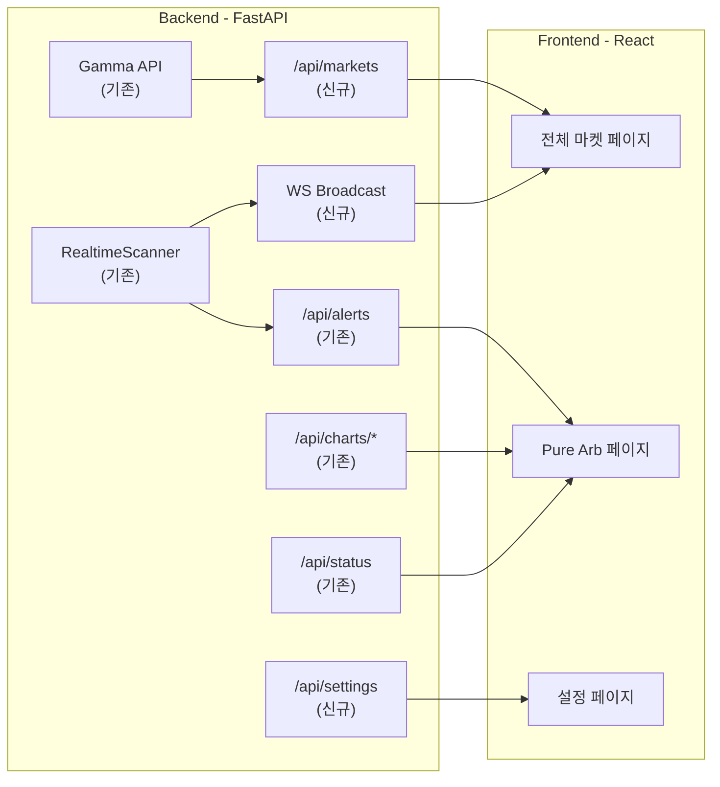

# Phase 2: 전체 마켓 + Pure Arb + 설정

## 현재 상태

- **사이드바** (`Sidebar.tsx`): 5개 메뉴 중 NegRisk만 활성, 나머지 `disabled: true`
- **백엔드 API** (`app.py`): Pure Arb 관련 엔드포인트 이미 존재
  - `/api/status` — 봇 상태 + 스캐너 통계
  - `/api/alerts` — Pure Arb 알림 (페이징)
  - `/api/near-miss-alerts` — 유동성 부족 알림
  - `/api/orders` — 주문 실행 내역
  - `/api/charts/hourly`, `daily-executions`, `daily-alerts` — 차트 데이터
  - `/api/arb-window-stats` — 기회 지속시간 통계
- **프론트엔드 인프라**: WebSocket 훅(`useWebSocket`, `useRealtimeData`), 공통 컴포넌트(`DataTable`, `StatCard`, `PriceChip`, `StatusBadge`, `AppTabs`), 타입(`Market`, `MarketPrices`, `BotStatus`) 이미 구축

## Phase 재정리

| Phase       | 범위                         |
| ----------- | -------------------------- |
| Phase 1     | NegRisk 차익거래 (완료/진행 중)     |
| **Phase 2** | **전체 마켓 + Pure Arb + 설정**  |
| Phase 3     | Executor (지갑 연결 + 자동매수/매도) |
| Phase 4     | 다중 사용자                     |

---

## Phase 2 구조



---

## Step 2a: 백엔드 API 확장

### 마켓 데이터 아키텍처 (Background Sync + DB)

> ⚠️ **이전**: `/api/markets` 요청마다 Gamma API를 직접 호출 (느림, 커버리지 1,000개 한계)
> ✅ **현재**: Background Sync Worker가 5분마다 Gamma → DB 동기화, API는 DB에서 즉시 응답

**구현 파일:**

| 파일 | 역할 | 상태 |
|---|---|---|
| `data/database.py` | `markets_cache` 테이블 스키마 + 인덱스 4개 | 완료 |
| `data/repositories.py` | `MarketCacheRepository` (upsert_batch, query, get_count, mark_stale) | 완료 |
| `data/market_sync.py` | `MarketSyncWorker` (5분 간격 Gamma→DB 동기화, 2,000개 커버리지) | 완료 |
| `dashboard/app.py` | `/api/markets` → DB 쿼리로 교체, in-memory 캐시 제거, startup에서 worker 시작 | 완료 |

**데이터 흐름:**

```
서버 startup → sync_once() 즉시 실행 → 2,000개 마켓 DB 적재
             → start() 5분 주기 루프 시작

/api/markets 요청 → MarketCacheRepository.query() → SQLite SELECT → 즉시 응답
                                                      ↓
                                                  검색 결과 0건이면
                                                  Gamma API slug fallback
```

### 엔드포인트

- **`GET /api/markets`** — DB에서 마켓 목록 조회 (검색/필터/정렬/페이징)
  - 파라미터: `limit`, `offset`, `sort_by` (volume/liquidity), `category`, `search`, `min_liquidity`
  - 검색 miss 시 Gamma API slug fallback
- **`GET /api/markets/by-slug/{slug}`** — 개별 마켓 상세 (Gamma API 직접)
- **`GET /api/markets/by-event/{event_id}`** — 이벤트 소속 마켓 (Gamma → DB fallback)
- **`GET /api/settings`** / **`PUT /api/settings`** — 봇 설정 조회/수정
- **`WebSocket /ws/stream`** — 실시간 브로드캐스트 (가격, Pure Arb 알림, NegRisk 알림)

### 기존 엔드포인트 활용 (변경 없음)

- `/api/alerts`, `/api/near-miss-alerts`, `/api/orders`
- `/api/charts/hourly`, `/api/charts/daily-*`
- `/api/status`, `/api/arb-window-stats`

---

## Step 2b: 전체 마켓 페이지

**경로**: `/markets`
**파일**: `frontend/src/pages/markets/MarketList.tsx`, `MarketDetail.tsx`

### MarketList 구성

- **상단**: 검색바 + 카테고리 필터 (Politics, Crypto, Sports 등) + 정렬 (거래량/유동성)
- **메인**: `DataTable`로 마켓 목록
  - 컬럼: 마켓명, YES/NO 가격 (`PriceChip`), Spread, 거래량, 유동성, 만기일, negRisk 배지
  - 행 클릭 → MarketDetail
- **실시간**: WebSocket으로 가격 업데이트 (깜빡임 효과)

### MarketDetail 구성

- 마켓 기본 정보 + 오더북 시각화 (bid/ask 깊이 차트)
- YES/NO 가격 추이 (ApexCharts line)
- negRisk 마켓이면 → NegRisk EventDetail로 링크

---

## Step 2c: Pure Arb 페이지

**경로**: `/arb`
**파일**: `frontend/src/pages/arb/PureArbDashboard.tsx`

### 구성

- **상단 StatCard 행**: 스캐너 상태, 모니터링 마켓 수, 탐지된 기회 수, 성공률
  - 데이터: `/api/status`
- **탭 구성** (`AppTabs`):
  1. **실시간 알림** — `/api/alerts` + WebSocket `arb` 채널
    - 테이블: 마켓명, YES ask, NO ask, Combined, 수익%, 유동성, 탐지시간
    - 새 알림 하이라이트 효과
  2. **Near Miss** — `/api/near-miss-alerts`
    - 유동성 부족으로 놓친 기회들
  3. **실행 내역** — `/api/orders` (Phase 3에서 실제 거래, 지금은 dry-run 로그)
  4. **통계/차트** — `/api/charts/daily-alerts`, `/api/arb-window-stats`
    - 일별 알림 추이 차트
    - 기회 지속시간 분포

---

## Step 2d: 설정 페이지

**경로**: `/settings`
**파일**: `frontend/src/pages/settings/Settings.tsx`

### 섹션

- **스캐너 설정**: min_profit_threshold, max_position_size, min_liquidity_usd, num_ws_connections
- **NegRisk 설정**: negrisk_enabled, negrisk_min_outcomes, negrisk_safety_margin, negrisk_min_roi
- **알림 설정**: slack_webhook, notifications_enabled
- **봇 모드**: dry_run 토글, poll_interval
- 각 값은 현재 설정값 표시 + 수정 가능 + "저장" 버튼

---

## Step 2e: 라우팅 + 사이드바 활성화

- `allRoutes.tsx`: 새 페이지 라우트 추가
- `Sidebar.tsx`: Phase 2 메뉴들 `disabled: false`로 전환, 포트폴리오 메뉴 제거

---

## 주요 파일 변경 요약

| 파일                                            | 변경                                               |
| --------------------------------------------- | ------------------------------------------------ |
| `src/karb/dashboard/app.py`                   | `/api/markets`, `/api/settings`, `/ws/stream` 추가 |
| `frontend/src/pages/markets/MarketList.tsx`   | 신규                                               |
| `frontend/src/pages/markets/MarketDetail.tsx` | 신규                                               |
| `frontend/src/pages/arb/PureArbDashboard.tsx` | 신규                                               |
| `frontend/src/pages/settings/Settings.tsx`    | 신규                                               |
| `frontend/src/routes/allRoutes.tsx`           | 라우트 4개 추가                                        |
| `frontend/src/layout/Sidebar.tsx`             | 메뉴 활성화, 포트폴리오 제거                                 |
| `frontend/src/types/market.ts`                | Pure Arb alert 타입 추가                             |
| `frontend/src/hooks/`                         | `useMarkets`, `usePureArbAlerts` 훅 추가            |
