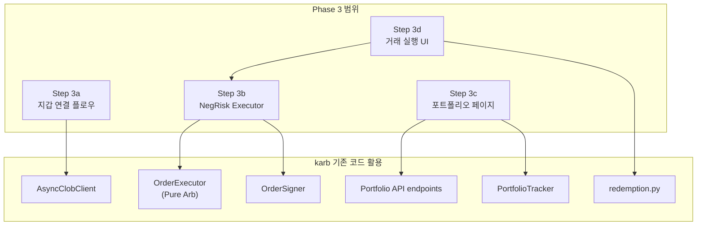

# Phase 3: 지갑 연결 + 자동매수/매도 + 포트폴리오

## 현재 상태 (karb에 이미 있는 것)

### 백엔드

- **`executor/executor.py`** (1462줄): `OrderExecutor` — Pure Arb용 YES+NO 동시 주문 (FOK), dry_run, emergency unwind, 부분 체결 처리
- **`executor/async_clob.py`** (806줄): `AsyncClobClient` — EIP-712 서명 + HMAC L2 인증, 주문 제출/취소/조회
- **`executor/signer.py`**: `OrderSigner` — EIP-712 order 서명, 주소 검증
- **`executor/redemption.py`**: 만기 포지션 자동 환수 (MATIC 가스비 체크 포함)
- **`tracking/portfolio.py`**: `PortfolioTracker` — USDC 잔고 (CLOB API + 온체인 fallback), 스냅샷, PnL 계산

### 백엔드 API (app.py에 이미 존재)

- `/api/balance` — USDC 잔고
- `/api/positions` — 보유 포지션 (Data API)
- `/api/closed-positions` — 청산 내역
- `/api/pnl` — 손익 요약
- `/api/redeemable` — 환수 가능 포지션
- `POST /api/redeem` — 환수 실행
- `/api/orders` — 주문 실행 내역
- `/api/charts/daily-balance` — 잔고 추이

### 인증에 필요한 것

| 항목                | 환경변수                  | 용도                   |
| ----------------- | --------------------- | -------------------- |
| Polygon 프라이빗 키    | `PRIVATE_KEY`         | EIP-712 서명 (주문 + 환수) |
| 지갑 주소             | `WALLET_ADDRESS`      | 프라이빗 키에서 자동 유도 가능    |
| L2 API Key        | `POLY_API_KEY`        | CLOB REST 인증         |
| L2 API Secret     | `POLY_API_SECRET`     | HMAC 서명              |
| L2 API Passphrase | `POLY_API_PASSPHRASE` | CLOB REST 헤더         |
| MATIC 잔고          | (온체인)                 | 가스비 (환수/온체인 트랜잭션)    |

- L2 credentials는 `py_clob_client`의 `create_or_derive_api_creds()`로 프라이빗 키에서 **자동 생성** 가능

---

## 구현 범위

---

## Step 3a: 지갑 연결 플로우

### 백엔드

- **`POST /api/wallet/validate`** (신규) — 프라이빗 키로 주소 유도 + L2 credentials 자동 생성 + USDC/MATIC 잔고 확인
  - 입력: `private_key` (HTTPS 전용, 로컬 전용이므로 OK)
  - 처리: `Account.from_key()` → 주소 유도, `ClobClient.create_or_derive_api_creds()` → API key/secret/passphrase 생성
  - 응답: 지갑 주소, USDC 잔고, MATIC 잔고, API key 생성 성공 여부
  - `.env`에 자동 기록 (또는 런타임 settings 오버라이드)
- **`GET /api/wallet/status`** (신규) — 현재 지갑 연결 상태
  - 지갑 주소 (마스킹), 연결 여부, dry_run 모드, USDC/MATIC 잔고
- **`POST /api/wallet/disconnect`** (신규) — 연결 해제 (런타임 settings 초기화)

### 프론트엔드

- **설정 페이지 내 "지갑 연결" 섹션** (Phase 2 Settings에 추가)
  - 프라이빗 키 입력 필드 (password type)
  - "연결" 버튼 → `/api/wallet/validate` 호출
  - 연결 상태 표시: 주소, 잔고, dry_run 토글
  - "연결 해제" 버튼
- **Topbar**: 지갑 연결 상태 아이콘 (연결/미연결/잔고 부족 경고)

---

## Step 3b: NegRisk Executor 구현

karb의 `OrderExecutor`는 **Pure Arb 전용** (YES+NO 동시 매수). NegRisk는 전략별로 다른 실행 로직이 필요:

### `src/karb/executor/negrisk_executor.py` (신규)

**Strategy A (YES_ARB) 실행:**

1. 모든 k개 아웃컴의 YES 토큰 매수 (병렬 FOK)
2. 완전 세트 merge → USDC 회수 (또는 만기 정산 대기)

**Strategy B (NO_CONVERT_ARB) 실행:**

1. 모든 k개 아웃컴의 NO 토큰 매수 (병렬 FOK)
2. k-1개 NO → YES 변환 (NegRiskAdapter 온체인 트랜잭션)
3. NO+YES merge (k-1회) + 완전 YES 세트 merge → USDC 회수
4. "하나 남기기" 최적화 적용

### 핵심 구현 사항

- `AsyncClobClient`의 `submit_orders_parallel` 확장: k개 주문 병렬 처리 (현재 2개)
- NegRiskAdapter 컨트랙트 호출: `web3.py`로 `convert()` 트랜잭션
  - 컨트랙트 주소: `NEG_RISK_EXCHANGE_ADDRESS` = `0xC5d563A36AE78145C45a50134d48A1215220f80a`
- merge 트랜잭션: CTF Exchange의 `mergePositions()` 호출
- 가스비 추정 + 수익성 재검증 (가스비 포함 순이익 > 0 확인)
- 부분 체결 / 실패 시 emergency unwind (기존 executor 패턴 재사용)
- `NegRiskExecutionRepository` (DB) — 실행 내역 저장

### 봇 통합

- `NegRiskBot`에 executor 연결: 기회 탐지 → 수익성 검증 → 실행
- `dry_run` 모드: 실행 시뮬레이션만 (DB 기록 + 알림)
- `bot.py`의 `run_negrisk_bot()`에 executor 옵션 추가

---

## Step 3c: 포트폴리오 페이지

**경로**: `/portfolio`
**파일**: `frontend/src/pages/portfolio/Portfolio.tsx`

### 구성

- **상단 요약 카드 행** (`StatCard`):
  - 총 자산 (USDC + 포지션 가치)
  - USDC 잔고
  - 미실현 PnL
  - 실현 PnL
  - MATIC 잔고 (가스비)
- **탭 1: 보유 포지션** — `/api/positions`
  - 테이블: 마켓명, 아웃컴, 수량, 평균가, 현재가, PnL, 상태
  - 행 클릭 → 마켓 상세 (Phase 2의 MarketDetail)
- **탭 2: 청산 내역** — `/api/closed-positions`
  - 테이블: 마켓명, 매수가, 청산가, 실현 PnL, 상태 (WON/LOST)
- **탭 3: 주문 내역** — `/api/orders`
  - 실행 내역 + 타이밍 데이터
- **탭 4: 환수** — `/api/redeemable`
  - 환수 가능 포지션 목록 + "전체 환수" 버튼 (`POST /api/redeem`)
  - MATIC 부족 경고
- **탭 5: 잔고 추이 차트** — `/api/charts/daily-balance`
  - 일별 USDC + 포지션 가치 + 총자산 라인 차트 (ApexCharts)
- **사이드바**: 포트폴리오 메뉴 복원 (Phase 2에서 제거했던 것)

---

## Step 3d: 거래 실행 UI

### NegRisk 탭 (Phase 1 확장)

- 기회 카드에 **"실행" 버튼** 추가 (지갑 연결 시에만 활성)
- 실행 전 확인 모달:
  - 전략 (YES_ARB / NO_CONVERT_ARB)
  - 예상 비용, 예상 수익, 가스비 추정
  - 슬리피지 허용범위 조정
  - dry_run 여부 표시
- 실행 중 상태 표시 (주문 제출 → 체결 → 변환 → merge → 완료)
- 실행 결과 토스트 알림

### Pure Arb 탭 (Phase 2 확장)

- 알림에 **"실행" 버튼** 추가 (자동 실행 모드에선 자동)
- `autoExecute` 설정에 따라 자동/수동 전환

### 백엔드 API

- **`POST /api/execute/negrisk`** (신규) — NegRisk 기회 수동 실행
  - 입력: `event_id`, `strategy`, `j_quantity`, `slippage_tolerance`
- **`POST /api/execute/pure-arb`** (신규) — Pure Arb 수동 실행
  - 입력: `condition_id`, `size`
- **`GET /api/executions`** (신규) — 전체 실행 내역 (Pure Arb + NegRisk 통합)

---

## 서명 및 인증 방식

### Phase 3 (로컬): 서버 서명

- 프라이빗 키를 서버(= 내 로컬 머신) 메모리에 보관
- 서버에서 EIP-712 서명 + 주문 제출 (자동화 가능)
- 로컬이므로 키 노출 위험 없음
- MetaMask / 클라이언트 서명 불필요

### Phase 4 (앱 배포 시): 클라이언트 서명 전환 검토

- Polymarket 웹과 동일하게 브라우저에서 서명하는 구조로 전환 가능
- 서버는 서명된 주문만 중계 (키를 모름)
- Magic SDK 또는 WalletConnect 연동

### 다중 사용자 확장

- 로그인/회원가입 없음 — 키 1개 = 사용자 1명
- 키를 바꾸면 사용자가 바뀜 (지갑 주소 기반 식별)
- 다중 사용자 시: 키별 세션 분리만 추가

---

## 선행 조건 (개발 전 필요)

1. **Polymarket 계정 생성** — [polymarket.com](https://polymarket.com)에서 지갑 연결
2. **Polygon 지갑** — MetaMask 등으로 생성, 프라이빗 키 확보
3. **USDC 입금** — Polygon 네트워크 USDC (테스트 시 소액)
4. **MATIC 입금** — 가스비용 (소량, ~$1 정도면 충분)
5. 처음에는 반드시 **`dry_run=true`**로 테스트

---

## 주요 파일 변경/생성

| 파일                                             | 변경                          |
| ---------------------------------------------- | --------------------------- |
| `src/karb/executor/negrisk_executor.py`        | **신규** — NegRisk 전략 실행      |
| `src/karb/executor/async_clob.py`              | k개 병렬 주문 확장                 |
| `src/karb/bot.py`                              | NegRiskBot에 executor 연결     |
| `src/karb/dashboard/app.py`                    | wallet API + execute API 추가 |
| `frontend/src/pages/portfolio/Portfolio.tsx`   | **신규**                      |
| `frontend/src/pages/settings/Settings.tsx`     | 지갑 연결 섹션 추가                 |
| `frontend/src/pages/negrisk/Opportunities.tsx` | 실행 버튼 + 모달                  |
| `frontend/src/pages/arb/PureArbDashboard.tsx`  | 실행 버튼                       |
| `frontend/src/layout/Sidebar.tsx`              | 포트폴리오 메뉴 복원                 |
| `frontend/src/layout/Topbar.tsx`               | 지갑 상태 표시                    |
| `frontend/src/types/portfolio.ts`              | **신규** — 포트폴리오 타입           |
| `frontend/src/types/execution.ts`              | **신규** — 실행 관련 타입           |
